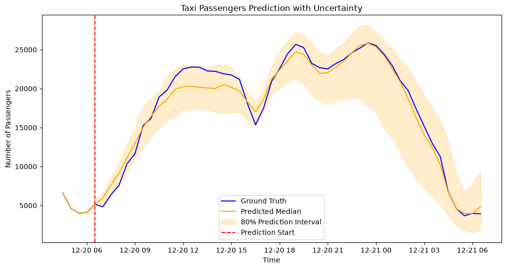

# futureish

Build probabilistic time-series forecasts that can adapt as new observations
arrive. `futureish` provides an online Gaussian-process model, a shared
forecasting interface for other models, and time-aware data preparation built
around Polars.

Use it when you need predictive uncertainty as well as forecasts, or want to
update a model over time instead of treating training as a one-off step.

Custom input features are rebuilt at every autoregressive step, so they can
respond to predictions made earlier along each forecast path.

- Online Gaussian-process forecasting with GPyTorch, including sparse and
  online PEP models
- Recorded, sparse, modular, calendar, cyclical, and bucketed input features
- Configurable target features and Z-score, Difference, and chained scalers
- Dataset workflows for training, testing, prediction, and online updates
- CatBoost and custom-model support through the common forecasting interface



Example autoregressive taxi-passenger forecast. The orange line is the median of
100 sampled predictions; the shaded band is the 10th–90th percentile interval
(80% prediction interval). The red line marks the forecast start.

## Installation

Requires Python 3.11 or later. Install from PyPI with:

```bash
pip install futureish
```

Or add it to a project managed with uv:

```bash
uv add futureish
```

The standard installation includes the PyTorch/GPyTorch and CatBoost
dependencies.

## Quick start

This example downloads a small slice of a public taxi-passenger dataset,
prepares lagged inputs, fits an online Gaussian-process model, and calculates
an 80% prediction interval from forecast samples:

```python
import polars as pl
import torch

from futureish.datapoints import RecordedDataPoint
from futureish.features import RecordedInputFeature, TargetFeature
from futureish.scaling import DiffScaler, ZScoreScaler, ChainedScaler
from futureish.datasets import Dataset
from futureish.gpr import GPyTorchOnlinePEP, GPyTorchFitConfig
from futureish.forecasting import Forecaster

data = (
    pl.read_csv(
        "https://github.com/unit8co/darts/raw/refs/heads/master/datasets/taxi_new_york_passengers.csv",
        try_parse_dates=True,
    )
    .rename({"#Passengers": "pas"})
    .head(2000)
)

pas_dp = RecordedDataPoint(name="pas", step_size="30m", known_future=False)
input_features = [
    RecordedInputFeature(pas_dp, feature_name="pas_lags", input_length="2h", scaler_factory=ChainedScaler.from_scalers(DiffScaler, ZScoreScaler)),
]
target_features = [
    TargetFeature(pas_dp, feature_name="pas_feature", scaler_factory=ChainedScaler.from_scalers(DiffScaler, ZScoreScaler))
]

dataset = Dataset(
    raw_data=data,
    input_features=input_features,
    target_features=target_features,
)

train_dataset, test_dataset = dataset.split_training_and_test_data(0.8)

model = Forecaster(GPyTorchOnlinePEP.wrapped(100, use_cuda=torch.cuda.is_available()))
model.fit(train_dataset, config=GPyTorchFitConfig(time_limit=60)) # train for 60 seconds
traj_data, ground_truth = test_dataset.create_prediction_trajectory(t0_offset="6h", pred_len="1d")
traj = model.predict_autoregressive(traj_data)
traj_sampled = model.predict_autoregressive(traj_data, samples=100)
traj_quantiles = (
    traj_sampled
    .group_by("time")
    .agg([
        pl.col("pas").quantile(0.1).alias("pas_10th_percentile"),
        pl.col("pas").quantile(0.5).alias("pas_median"),
        pl.col("pas").quantile(0.9).alias("pas_90th_percentile"),
    ])
    .sort("time")
)
```


For a complete, runnable walkthrough, see the
[example notebook](examples/example.ipynb).


Raw data must contain a `time` column and the columns referenced by the
configured datapoints. Feature names must be unique, and target datapoints
define the forecasting step size.

## Core concepts

### Datapoints

`RecordedDataPoint` describes a value in the raw data: its column name,
recording step size, and whether future values are known. Input and target
features refer to datapoints.

```python
from futureish.datapoints import RecordedDataPoint
```

### Input Features

Features define how datapoints become model inputs. Available built-in features
include:

- `RecordedInputFeature`: current values and optional historical lags
- `SparseInputFeature`: selected lags at a configurable reduction factor
- `ModularInputFeature`: custom feature generation from a Polars dataframe
- `BucketInputFeature`: bucketed lag features with customizable aggregation
- `SinCosTimeFeature`: cyclic time features encoded with sine and cosine
- `BusinessDayFeature`: business-day indicators, optionally including day
  history

Features can be scaled before fitting. For example, `RecordedInputFeature`
supports `input_length` to configure the history included and
`uses_future_data=True` when the future value is known at prediction time.

Custom input features can subclass `InputFeatureBase`.

```python
from futureish.features import (
    BusinessDayFeature,
    BucketInputFeature,
    ModularInputFeature,
    RecordedInputFeature,
    SinCosTimeFeature,
    SparseInputFeature,
    TargetFeature,
)
```

### Target Features

`TargetFeature` defines the values the model learns to predict and maps
predictions back to the raw-data format. It can apply scaling and optional
bounds. Target datapoints also determine the forecasting step size.

### Scalers

Scalers transform feature values before model fitting and invert predictions
back to the original scale. Built-in scalers include `ZScoreScaler` and
`DiffScaler`; `ChainedScaler` composes multiple scalers when multiple
transformations are needed.

#### ZScoreScaler

```python 
(x - x.mean()) / x.std()
```

#### DiffScaler

$x = t_{-1} - t_0$

#### Custom Scalers

Custom scalers can subclass `ScalerBase`, or `DataScaler` when the
transformation can be expressed as a Polars expression (`pl.Expr`).

### Dataset

`Dataset` combines raw time-series data with input and target features. It
validates and prepares feature columns, fits scaling configuration on training
data, and can produce `TrainDataset` and `TestDataset` instances. Use
`split_training_and_test_data` to create train and test datasets, or
`to_train_dataset` to convert the full dataset for training. Datasets also
provide `iter` and `random_subset` methods.

#### TrainDataset
Pass a `TrainDataset` to `Forecaster.fit` to train a model.

##### OnlineDataset
An online dataset specifies the size of the first training step, limiting the
data available when fitting scalers.

#### OnlineTrainingDataset
The training dataset produced by an `OnlineDataset`.

#### TestDataset
Used to evaluate a model and prepare predictions:

- `create_prediction_trajectory` creates one prediction trajectory
- `create_all_trajectories` creates trajectories across the available data
- `create_all_single_inputs` creates inputs for one-step-ahead predictions

### Features during autoregressive forecasting

At every autoregressive step, `futureish` builds the current input window and
creates the input features again. Earlier predictions are added to the
working target series; for sampled forecasts, each sample has its own path.
This lets a custom feature depend on the values actually predicted along that
path, rather than only on a fixed set of future covariates.

For example, this feature measures how far the most recent value is from the
mean of the trailing six hours. During recursive prediction, that window can
include predictions from earlier steps:

```python
import polars as pl

from futureish.datapoints import RecordedDataPoint
from futureish.features import ModularInputFeature, TargetFeature


def recent_deviation(dataframe, _time_column, value_column, group_columns):
    return dataframe.group_by(group_columns).agg(
        (pl.col(value_column).last() - pl.col(value_column).mean())
        .alias("recent_deviation")
    )


load = RecordedDataPoint(name="load", step_size="1h")
input_feature = ModularInputFeature(
    base_datapoint=load,
    feature_name="load_momentum",
    input_length="6h",
    modification_expression=recent_deviation,
)
target_feature = TargetFeature(base_datapoint=load, feature_name="load_target")
```

Use `input_feature` and `target_feature` in a `Dataset` as usual. The
differentiator is the recomputation: a single precomputed future-covariate
series cannot know the future values of each sampled path. Other libraries,
including Darts, can implement related behavior with custom prediction loops;
`futureish` makes this path-dependent feature generation part of its
autoregressive workflow.

### Forecaster

`Forecaster` combines a model with the dataset configuration. It supports
fitting and incremental fitting, point or distributional predictions,
autoregressive multi-step forecasts, samples, and forecast error metrics.

### Models

Models implement the common model interface used by `Forecaster`, allowing
different backends to be exchanged without changing the data pipeline. The
project currently provides GPyTorch Gaussian-process models, including sparse
and online PEP variants, and a CatBoost time-series model.

#### Gaussian-process models

The GPyTorch models provide predictive uncertainty:

- `GPyTorchOnlinePEP`: online-trainable Gaussian-process regression
- `GPyTorchSGP`: sparse Gaussian-process model
- `GPyTorchVGP`: variational Gaussian-process model

Wrap a GPyTorch model to use it with `Forecaster`:

```python
Forecaster(GPyTorchOnlinePEP.wrapped(...))
```

The wrapper accepts a number of inducing points and a custom kernel built from
GPyTorch kernels.

#### CatBoost

A CatBoost backend is also available through the model interface.

#### Custom models

Create a custom model by subclassing `ABCModel` and implementing `_fit` and
`_predict_mean`. `_predict` and `_predict_sample` can also be implemented.

## Status

`futureish` is under active development. Public APIs and model behavior may
change as the library evolves.

Questions, bug reports, and feedback are welcome in
[GitHub Issues](https://github.com/jaschn/futureish/issues).

**Copyright © [2026] Technical University of Denmark**